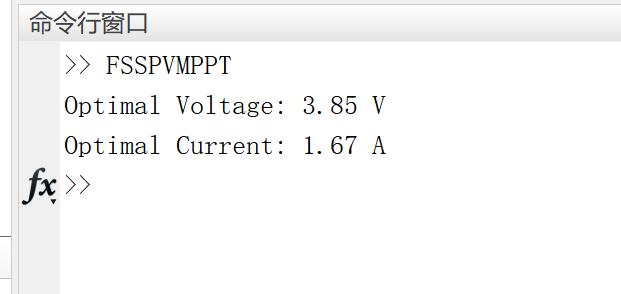

# Flight Squirrel Search Optimization (FSSO) for Solar Photovoltaic (PV) Maximum Power Point Tracking (MPPT) (Matlab Code Implementation)

Flight Squirrel Search Optimization (FSSO) is used for maximum power point tracking (MPPT) in solar photovoltaic (PV) systems. The provided MATLAB script demonstrates the implementation of MPPT using the Flight Squirrel Search Optimization (FSSO) algorithm in a solar PV system. The FSSO algorithm mimics the behavior of flight squirrels to optimize solutions.

The script initializes a set of "squirrels" (representing potential solutions), and iteratively updates their positions based on fitness evaluation and movement rules. The goal is to find the optimal voltage and current values that yield the highest power output from the PV system.

The fitness function calculates the power output based on the voltage and current values. The algorithm dynamically updates the positions of the squirrels towards improved solutions, aiming to converge to the best combination of voltage and current that maximizes power output.

The FSSO algorithm provides a unique optimization method that simulates the behavior of flight squirrels seeking the best solution. The adaptive function, movement rules, and parameters of the script can be adjusted to match specific characteristics of the solar PV system.

## Images

<!-- PAYMENT_BLOCK -->

## Get this dataset

- Payment link (Stripe): [Buy now](https://buy.stripe.com/3cs8yP7sY87d0vu9AB)
- Payment QR code: 

<!-- /PAYMENT_BLOCK -->
